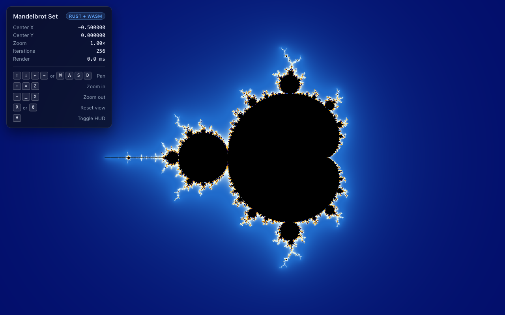

# Mandelbrot Set Viewer (Rust + WebAssembly)

An interactive, browser-based **Mandelbrot set** fractal explorer powered by **Rust** compiled to **WebAssembly (WASM)** and rendered on an **HTML5 Canvas**.



## How It Works

### The Mandelbrot Set
Every pixel on the screen represents a complex number $c = x + yi$. For each pixel, we start with $z_0 = 0$ and repeatedly apply:

$$z_{n+1} = z_n^2 + c$$

- If the magnitude $|z_n|$ stays bounded (never exceeds $2$), the point $c$ is **inside** the Mandelbrot set and is colored black.
- If $|z_n|$ escapes past $2$, the number of iterations it took (smoothed with a continuous logarithmic formula to eliminate color banding) is mapped to a rich blue-to-gold color palette.

### Why Rust + WebAssembly?
Computing hundreds of iterations for every pixel on a full-screen canvas is CPU-intensive. Writing the escape-time renderer in **Rust** (`src/lib.rs`) and compiling it to **WebAssembly** with `wasm-pack` lets the browser execute the math at near-native speed:

1. **Rust (`src/lib.rs`)** exposes `render_mandelbrot(width, height, center_x, center_y, zoom, max_iter)`, returning a flat RGBA byte array (`Uint8Array`).
2. **JavaScript (`www/app.js`)** loads the compiled WASM module (`www/pkg/mandelbrot.js`), wraps the returned pixels in an `ImageData` object, and draws them onto the `<canvas>` with `ctx.putImageData()`.
3. **Keyboard controls** update the viewport coordinates and zoom level, automatically scaling the iteration count as you zoom deeper for sharp fractal detail.

## Prerequisites

Make sure the following tools are installed:

- **Rust & Cargo** — install via [rustup.rs](https://rustup.rs/)
- **WebAssembly target**:
  ```bash
  rustup target add wasm32-unknown-unknown
  ```
- **`wasm-pack`** — builds the Rust crate and generates JavaScript glue code:
  ```bash
  cargo install wasm-pack
  # or on macOS with Homebrew:
  brew install wasm-pack
  ```
- **Python 3** — used by `make run` to serve the `www/` directory over HTTP (with proper `application/wasm` MIME type)
- **`make`** — included with macOS Xcode Command Line Tools and most Linux distributions

## Quick Start & Make Targets

| Command | Description |
| --- | --- |
| `make run` | Builds the WASM module (if needed), starts a background HTTP server on port `8080`, saves its PID to `.server.pid`, and prints the URL (`http://localhost:8080`). |
| `make stop` | Cleanly stops the background HTTP server using `.server.pid` and removes the PID file. |
| `make test` | Runs the Rust unit test suite (`cargo test`). |
| `make build` | Force-rebuilds the Rust/WASM module into `www/pkg/`. |
| `make clean` | Stops any running server and removes generated build artifacts (`www/pkg/`, `target/`, `.server.pid`). |
| `make help` | Prints a summary of all available Make targets. |

### Starting and Stopping the Viewer

```bash
# Run the Rust unit tests
make test

# Build WASM (if needed) and start the local server
make run
# -> Open http://localhost:8080 in your browser

# Optional: run on a different port
make run PORT=9000

# Stop the background server when finished
make stop
```

## Keyboard Controls

| Keys | Action |
| --- | --- |
| `↑` `↓` `←` `→` or `W` `A` `S` `D` | Pan the view (up, down, left, right) |
| `+`, `=`, or `Z` | Zoom in |
| `-`, `_`, or `X` | Zoom out |
| `R` or `0` | Reset to the default view (`center = (-0.5, 0.0)`, `zoom = 1.00×`) |
| `H` | Toggle the HUD overlay on/off |

Hold a movement or zoom key for smooth continuous motion, or tap it for small steps.

## Project Structure

```text
mandelbrot/
├── Cargo.toml            # Rust crate configuration (wasm-bindgen dependency, cdylib target)
├── Makefile              # Build, run, stop, test, and clean automation
├── README.md             # Project documentation and usage guide
├── docs/
│   └── mandelbrot.png    # Screenshot of the running Mandelbrot viewer
├── src/
│   └── lib.rs            # Rust Mandelbrot renderer, smooth coloring, WASM export, and unit tests
└── www/
    ├── index.html        # Full-viewport canvas page and HUD overlay markup
    ├── style.css         # Dark theme and glassmorphic HUD styling
    ├── app.js            # WASM loader, canvas rendering loop, and keyboard controls
    └── pkg/              # Generated by `wasm-pack build` (ignored by git)
```
